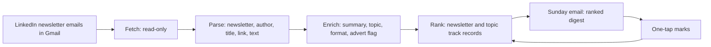

# LinkedIn Newsletter Digest Agent

An agent that turns a week of LinkedIn newsletter emails into one ranked digest every Sunday morning, and learns what to put on top from three one-tap marks: **Worth it**, **Read later** and **Not interested**.

**Status: in development.** Version 1 is being built and tested on my own inbox. It will be released as open source for anyone to run in their own Google account once it has run live for four Sundays. The source code is in a private repository until then.

---

## The problem

Subscribing to LinkedIn newsletters is easy; keeping up with them isn't. A busy subscription list sends dozens of editions a week as separate emails. Most go unread, and the few worth reading are buried among near-daily ones that never are.

Email filters can't tell a good edition from a bad one, and LinkedIn's own feed ranks by what is popular, not by what a particular reader finds worth their time.

## How it works

1. **Fetch.** Every Sunday, the agent reads the week's newsletter emails through the Gmail API, with read-only access.
2. **Parse.** Each email becomes one edition: the newsletter, author, title, a clean article link and the article text. The email is cut at its footer before anything is read, so unsubscribe links and their personal tokens are never touched.
3. **Enrich.** A language model writes a 2 to 4 sentence summary and labels the topic, the format, the angle and whether the edition is an advert or a job list. Every reply is checked against the allowed labels before it is stored.
4. **Rank.** Each edition is scored from the reader's own track record with its newsletter (60%) and its topic (40%). Two discovery slots go to newsletters with too few marks to judge. A newsletter the reader keeps rejecting is muted automatically.
5. **Deliver.** One HTML email arrives on Sunday morning, with signed one-tap links on every article for Worth it, Read later, Not interested and Mute.
6. **Learn.** Each mark is logged and feeds the next week's ranking.

Everything runs as one Google Apps Script project with a Google Sheet as its memory. There is no server, it runs while the laptop is off, and each user's data stays in their own Google account.

## What the evidence showed before any code was written

A hand-made sample digest came first (Phase 0), covering seven weeks of real newsletter emails: 274 editions, with 250 of them marked Worth it, Read later or Not interested. Analysing those marks shaped the product:

- **The newsletter predicts interest better than the topic.** A ranking built on each newsletter's track record put far more liked articles in the top 10 than one built on topics or keywords.
- **Frequency matters.** Near-daily newsletters scored about a quarter as well as those that sent two to four editions in seven weeks. That is why muting exists.
- **The same publisher can score completely differently** across its newsletters, so track records are kept per newsletter, not per publisher.
- **Opening an article is a weak signal.** Of the articles opened in the sample, about half ended up marked Not interested. The ranking therefore learns from marks only, not from clicks.

## Results so far

On a five-week test, each week was ranked using only the marks from earlier weeks, the way the live product will work.

| Ranking | Top 10 marked Worth it or Read later |
|---|---|
| Newest first | 44% |
| A starter list of interests | 44% |
| Version 1: newsletter and topic track records | 66% (70% with the chosen model's labels) |

The enrichment model was chosen by a rule written down **before** the test ran: use the cheaper model unless it misses the targets or falls more than 2 points behind. The cheaper model reached 64% against 70%, missed two of the three targets, and hid 8 liked articles as adverts, so the larger model was chosen. Details are in [docs/evaluation.md](docs/evaluation.md).

## Build progress

| Phase | Status |
|---|---|
| 0. Sample digest and baseline marks | Done |
| 1. Foundations: repository, Sheet, Apps Script project | Done |
| 2. Fetch and parse | Done: matches the sample on all 47 emails of a test week |
| 3. Enrich | Done: model chosen on the ranking test |
| 4. Rank | Next |
| 5. Sunday email and one-tap marks | To do |
| 6. Schedule, failure alerts, four live Sundays | To do |
| 7. Open-source release with a setup guide | To do |

## What's in this repository

| File | What it holds |
|---|---|
| [docs/decisions.md](docs/decisions.md) | The product decisions, with the options considered and the evidence behind each |
| [docs/evaluation.md](docs/evaluation.md) | The ranking test, the model choice and the targets |
| [docs/privacy-and-security.md](docs/privacy-and-security.md) | What the agent reads, what it never stores, and the security issues found and fixed |
| [docs/roadmap.md](docs/roadmap.md) | The plan to release it for others, and the experiments after version 1 |

## Built with

Google Apps Script, Google Sheets, the Gmail API (read-only), the Claude API, Python for the offline ranking test, and Claude Code as the build environment.
